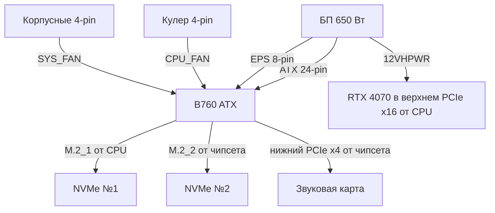

# Сборка ПК без BIOS

У клиента корпус Mid-Tower под ATX, mATX и Mini-ITX, блок 650 Вт с одним EPS 8-pin и одним ATX 24-pin, кулер 4-pin PWM. Нужны игры в 1440p, стрим, второй NVMe и звуковая карта.

Беру **вариант A**: Core i5-13600K, плата ATX B760, 2×16 ГБ DDR5-6000, RTX 4070, NVMe 1 ТБ, башня до 180 Вт.

## Задание 1

### 1.1. Корпус

По размеру подходят все три.

- ATX — 305 × 244 мм. Платы A и C.
- mATX — 244 × 244 мм. Плата B.
- Mini-ITX — 170 × 170 мм. В наборах такой платы нет, корпус её тоже принимает.

Плата B меньше ATX и встаёт в этот корпус, если стойки стоят в отверстиях mATX.

### 1.2. Второй NVMe и звуковая карта

Не подходит **вариант B**. Нет второго **M.2 Key M**.

На плате B один Key M и один Key E. Key M уже занят диском на 1 ТБ. Key E — слот под Wi-Fi. Вырез у Key M и Key E в разных местах, NVMe туда не вставляется. Переходник вырез не переносит. По линиям Key E обычно x1, этого мало для быстрого SSD.

**Вариант C** тоже не подходит. Там один M.2. Второй NVMe можно воткнуть только переходником в единственный PCIe x1, и тогда некуда ставить звуковую карту.

У варианта A два M.2 Key M и отдельные слоты под звук. Видеокарта остаётся в своём x16 от CPU.

### 1.3. Блок питания

Считаю турбо CPU + GPU + 50 Вт.

| Набор | Сумма | До 650 Вт остаётся |
|---|---|---|
| A | 181 + 200 + 50 = 431 Вт | 219 Вт |
| B | 142 + 200 + 50 = 392 Вт | 258 Вт |
| C | 65 + 115 + 50 = 230 Вт | 420 Вт |

По ваттам проходят все. У платы A есть EPS 8-pin и ещё 4-pin. Одного 8-pin на 181 Вт хватает, 4-pin в комплекте блока нет. RTX 4070 питается отдельно, разъёмом 12VHPWR.

### 1.4. Выбор

Для 1440p и стрима оставляю A.

- VRM 12+1 фаз нормально держит турбо 181 Вт. У C всего 6+1, это плата под CPU на 65 Вт.
- B760 включает XMP, комплект DDR5-6000 на Intel поднимается этим профилем. Плата C под DDR4, туда эти модули не встанут. 16 ГБ для стрима мало.
- У A видеокарта и первый NVMe сидят на линиях CPU. Второй NVMe и звуковая карта садятся на чипсет и не отнимают x16 у GPU.
- У i5-13600K больше ядер и есть встроенная графика. RTX 4070 в 1440p тянет игру и кодирование. RTX 4060 в том же режиме уже слабее.

## Задание 2. Линии PCIe

У i5-13600K от процессора 16 линий PCIe 5.0 на видеокарту и 4 линии PCIe 4.0 на первый M.2. Чипсет B760 связан с CPU по **DMI 4.0 x4**.

### 2.1

| Устройство | Слот | Откуда линии | Версия | Линий |
|---|---|---|---|---|
| RTX 4070 | верхний PCIe x16 | CPU | слот Gen5, карта работает как 4.0 | x16 |
| NVMe №1 | M.2_1 Key M | CPU | Gen4 | x4 |
| Звуковая карта | нижний PCIe x16 (electrical x4) | чипсет | x4 у слота | у карты обычно x1 |
| NVMe №2 | M.2_2 Key M | чипсет | Gen4 | x4 |

### 2.2

Короткая карта x1 в длинный слот x16 влезает и работает. Длинную карту в короткий слот поставить нельзя: она не влезет.

Слот даёт 4 линии. Звуковая карта берёт одну. Линк будет **x1**. Для звука этого хватает.

### 2.3

Второй NVMe, сеть 2.5G и USB 3.2 сидят на чипсете. В процессор они идут одним каналом **DMI 4.0 x4**, около 8 ГБ/с на всех.

Один NVMe Gen4×4 может занять этот канал целиком. Пока идёт копирование, сеть и USB делят остаток, диск не держит полную скорость. Первый NVMe на линиях CPU и этот канал не занимает.

### 2.4

На плате A слота Key E нет. Оба M.2 — Key M.

NVMe в Key E не ставится. Вырез другой, модуль не защёлкивается. Слот разведён под Wi-Fi: обычно x1 и USB, не четыре линии Gen4.

## Задание 3. Питание

### 3.1. Нет сигнала PWR_OK

1. Кнопка Power замыкает контакт на плате.
2. Плата опускает **PS_ON#**, блок включается.
3. Появляются +12 В, +5 В и +3.3 В. Вентиляторы могут уже крутиться.
4. Блок должен поднять **PWR_OK**, когда напряжения в норме.
5. Пока PWR_OK нет, процессор стоит в сбросе. POST не начинается, экрана нет.

### 3.2. Зачем 12+1 фаз

181 Вт при примерно 1,2 В — это около 150 А. Двенадцать фаз делят этот ток, каждая греется меньше. Ещё одна фаза питает встроенную графику.

На плате с VRM 6+1 тот же ток ляжет на шесть фаз. Они перегреются, частоты упадут, под нагрузкой плата может выключиться. Для i5-12400F на 65 Вт таких фаз хватает. Для 181 Вт нет.

### 3.3. Только EPS 8-pin

Подключить один 8-pin можно, плата включится. На 181 Вт разъёма хватает.

Пустой 4-pin — это меньший запас. На длинном турбо сильнее греются пины и кабель, плата может срезать лимит мощности. Разгонять так не стоит. Второй косички EPS у блока клиента нет.

### 3.4. 24-pin и EPS 8-pin

ATX 24-pin питает плату: +3,3 В, +5 В, +12 В, дежурные 5 В, сигналы PS_ON# и PWR_OK. От него работают чипсет, слоты и USB.

EPS 8-pin — только +12 В и земля, большим током на VRM процессора. Процессору нужно около 1 В, его делает VRM из этих 12 В.

От 24-pin процессор не запитать. Вход VRM разведён на гнездо EPS. В большом разъёме мало жил на 12 В, они не рассчитаны на ток ядра.

## Задание 4. Память

### 4.1

Пока XMP не включён, плата берёт обычный профиль JEDEC из SPD. У комплекта DDR5-6000 это обычно **4800 МТ/с** и тайминги около CL40, не 6000 CL30.

XMP — отдельный профиль, его надо включить самому. На Intel включается XMP. EXPO — такой же профиль для AMD.

### 4.2

- Слотов четыре, 4×16 ГБ физически встают.
- Два модуля на канал тяжелее для линий. 6000 часто не проходит, скорость падает примерно к 5200 или 4800.
- Ограничение в контроллере памяти процессора. Пара модулей на 6000 у 13600K идёт нормально, четыре планки — уже хуже.

### 4.3

DDR4 в плату DDR5 не встаёт. Вырез на планке в другом месте. Напряжение и распиновка тоже другие: DDR4 берёт 1,2 В с платы, у DDR5 около 1,1 В и свой преобразователь на модуле.

### 4.4

При первом включении UEFI подбирает задержки и напряжения, пока чтение не станет стабильным. Это тренировка памяти. Удачный результат плата запоминает.

Если профиль XMP не тренируется, прошивка откатывается на JEDEC. Для этого комплекта это **4800 МТ/с**.

## Задание 5

Набор Intel, поэтому ниже Adaptive Voltage, не PBO.

### 5.1

От шума в простое помогают **Smart Fan** и **Zero RPM**. На частоты процессора они не влияют.

Smart Fan меняет обороты по температуре. До 50 °C около 30 %, к 70 °C около 70 %, к 85 °C все 100 %. В игре кулер раскручивается, на рабочем столе почти тихий.

Zero RPM останавливает вентилятор ниже порога. Порог я бы поставил около 45 °C по CPU. Выше порога обороты снова берёт Smart Fan.

### 5.2

Adaptive Voltage даёт высокое напряжение только на высоких частотах. В простое оно падает. Сверху ставят небольшой минус, около **−50…−100 мВ**.

Под нагрузкой температура ниже примерно на **5–10 °C**. Если процессор упирался в нагрев, частота под долгим стримом может держаться на **100–200 МГц** выше. PBO и Curve Optimizer есть у Ryzen, у 13600K их нет.

### 5.3

Если новый CPU не записан в текущем BIOS, плата не стартует. Прошивку льют кнопкой Flashback, процессор для этого не нужен.

1. Скачать BIOS этой платы, где новый CPU уже есть.
2. Переименовать файл, как написано в руководстве. У MSI часто получается `MSI.ROM`.
3. Положить файл в корень флешки FAT32.
4. Подключить блок к плате и включить его тумблером. Кнопку Power не нажимать.
5. Вставить флешку в порт Flashback.
6. Нажать кнопку Flashback и дождаться, пока индикатор перестанет мигать.
7. После этого ставить процессор.

### 5.4

Zero RPM — это низ той же кривой, что и Smart Fan. Ниже порога обороты нулевые. Выше порога скважность задаёт Smart Fan. Между остановкой и стартом оставляют несколько градусов, чтобы вентилятор не дёргался на границе.

Если порог Zero RPM поставить выше критической температуры VRM, вентилятор будет стоять, когда силовая часть уже перегрета. Порог остановки должен быть ниже, примерно 45–50 °C, при критических около 100 °C.

## Задание 6

| № | Причина | Что сделать |
|---|---|---|
| 6.1 | Корпус mATX принимает. Если плата не садится, стойки стоят в отверстиях ATX или мешает кожух. | Переставить стойки в метки mATX. |
| 6.2 | GPU во втором слоте. Он длинный, но по линиям только x4, поэтому FPS проседает. | Поставить карту в верхний слот x16 от CPU. |
| 6.3 | Четыре модуля не проходят тренировку на частоте EXPO. | Оставить две планки в слотах A2 и B2. |
| 6.4 | VRM 6+1 не тянет турбо 181 Вт, фазы греются, CPU сбрасывает частоту. | Ставить такой CPU на плату с VRM 12+1, как в наборе A. |
| 6.5 | Старый BIOS B650 не знает Ryzen 9000, POST не начинается. | Обновить BIOS через Flashback с флешки, без CPU. |
| 6.6 | Кулер не в CPU_FAN или разъём отдаёт постоянные 12 В, кривая его не крутит. | Подключить 4-pin в CPU_FAN и включить PWM. |
| 6.7 | Карта x1 в слоте x16 electrical x4 работать должна. Не видится, если плохо вставлена или слот делит линии с занятым M.2. | Перевоткнуть карту или переставить её в свободный PCIe x1. |

## Задание 7. Схема

- ATX 24-pin — в плату. EPS 8-pin — в гнездо CPU. EPS 4-pin пустой.
- 12VHPWR — в RTX 4070.
- Видеокарта только в верхнем PCIe x16 от CPU.
- Первый NVMe в M.2_1, линии CPU. Второй потом в M.2_2, линии чипсета.
- Кулер в CPU_FAN, корпусные вентиляторы в SYS_FAN. Оба 4-pin, чтобы работал PWM.
- Звуковая карта в нижний слот x16 electrical x4 или в PCIe x1. Оба от чипсета.

Ограничения:

- EPS 4-pin не подключён. 181 Вт на одном 8-pin ещё допустимы, разгон нет.
- Второй M.2, звуковая карта, USB и сеть 2.5G делят DMI 4.0 x4.
- Четыре планки DDR5-6000 с XMP лучше не ставить. Рабочий вариант — 2×16 ГБ.
- Нижний длинный слот по линиям только x4.
- Порог Zero RPM должен быть ниже критической температуры VRM.
