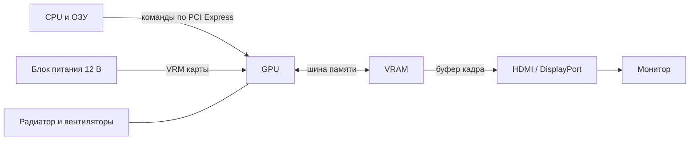

# Видеокарта

Данные с моего ПК, `nvidia-smi`, 25.11.2026. Карта NVIDIA GeForce RTX 3050, плата MSI.

## Часть 1. Теория

### Пять блоков

1. **GPU** — считает шейдеры и собирает кадр.
2. **VRAM** — хранит текстуры, буфер кадра и другие данные карты.
3. **Шина памяти** — связывает GPU с микросхемами VRAM. От ширины шины зависит скорость.
4. **PCI Express** — через него CPU передаёт на карту команды и данные.
5. **Разъёмы HDMI и DisplayPort** — отдают готовый кадр на монитор.

### GPU и CPU

У CPU несколько больших ядер. Он быстро делает разные задачи по очереди: система, логика игры, подготовка кадра.

У GPU тысячи простых блоков. Они хорошо повторяют одну операцию над большим объёмом данных: пиксели, вершины, матрицы.

CPU выгоднее для ветвящегося кода. GPU выгоднее, когда одно и то же действие нужно миллионам элементов сразу.

### VRAM и ОЗУ

VRAM стоит на видеокарте. Это GDDR или HBM с широкой шиной. ОЗУ стоит на материнской плате, это DDR, ею пользуется процессор.

Кадр и текстуры лежат в VRAM, потому что GPU читает их очень часто. Если бы они лежали в ОЗУ, данные шли бы через PCI Express. Эта шина уже местной шины памяти, карта простаивала бы.

### SIMT

SIMT — Single Instruction, Multiple Threads. Одна инструкция выполняется сразу многими потоками, у каждого свои данные.

NVIDIA собирает потоки в варп по 32 штуки. Планировщик даёт варпу одну команду, и все 32 потока делают её над своими числами. Пока один варп ждёт память, считается другой. Если соседние потоки уходят в разные ветки условия, часть варпа в этот момент простаивает.

### Охлаждение и питание

GPU переводит в тепло десятки ватт на маленьком кристалле. VRM карты делает из 12 В блока питания низкое напряжение большим током для ядра. Радиатор и вентиляторы снимают тепло с кристалла и с цепей питания.

Если охлаждение не справляется, карта сначала снижает частоты. Потом срабатывает защита, и она останавливается или компьютер выключается.

## Часть 2. Схема

CPU по PCI Express отдаёт команды и то, чего ещё нет в видеопамяти. GPU читает данные из VRAM и пишет туда готовый кадр. Разъём вывода забирает кадр из VRAM и шлёт его на монитор.

## Часть 3. Практика

| Параметр | Значение |
|---|---|
| Модель | NVIDIA GeForce RTX 3050 8 ГБ, плата MSI |
| VRAM | 8192 МиБ |
| Тип памяти | GDDR6 |
| Шина | 128 бит |
| Ядра | 2560 CUDA |
| Лимит питания | 115 Вт |
| Интерфейс | PCIe 4.0 |
| Частота памяти в nvidia-smi | 7001 МГц |

Формула: частота (МГц) × ширина шины (бит) / 8.

7001 × 128 / 8 = 112016 МБ/с ≈ **112 ГБ/с**.

`nvidia-smi` показывает частоту без множителя DDR. Эффективная скорость 7001 × 2 = 14002 МТ/с.

14002 × 128 / 8 = 224032 МБ/с ≈ **224 ГБ/с**.

В паспорте RTX 3050 8 ГБ тоже **224 ГБ/с**.

### От кнопки «Играть» до картинки

1. Система запускает процесс игры. CPU выполняет код игры и драйвера.
2. CPU читает файлы с SSD в оперативную память.
3. Драйвер по PCI Express копирует в VRAM текстуры, модели и шейдеры.
4. Каждый кадр CPU считает логику и отправляет на карту список команд.
5. GPU выполняет команды и берёт данные из VRAM.
6. Готовый кадр записывается в буфер в той же VRAM.
7. HDMI или DisplayPort читает буфер и показывает кадр на мониторе.

Если VRAM не хватает, драйвер добирает данные из ОЗУ через PCI Express во время кадра. Появляются просадки.
